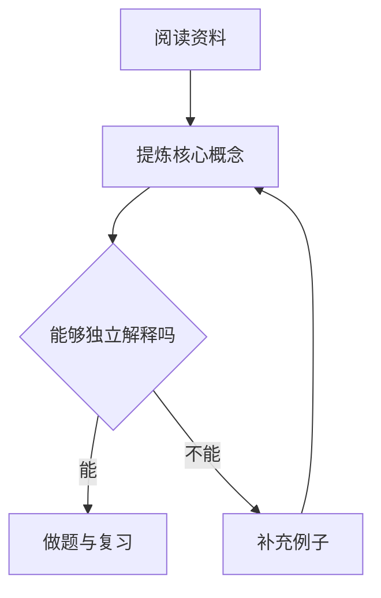
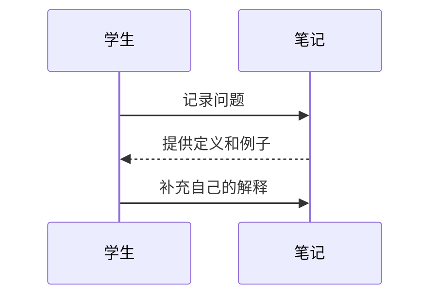

# Markdown 语法字典

按语法类别组织的查询手册，收录**语法格式、规则、示例、组合方式、限制与兼容性**。通用部分以 CommonMark 为基础，另列 GFM、数学、Mermaid 和 Obsidian 扩展。

软件专属条目以 Obsidian 为主。代码框内为语法原文，代码框外的示例用于对照显示效果。带“示例”说明的路径和附件名是占位内容，不代表文件已存在。

## 查询索引

| 查询内容 | 词条 |
| --- | --- |
| 规范差异、扩展范围 | [范围与兼容性](#范围与兼容性) |
| 空格、缩进、块级与行内语法 | [通用解析规则](#通用解析规则) |
| `#`、`##`、下划线式标题 | [标题](#标题) |
| 空行、行末空格、行末反斜杠 | [段落与换行](#段落与换行) |
| `*`、`**`、`~~`、`==` | [强调与删除线](#强调与删除线) |
| `-`、`1.`、嵌套与缩进 | [列表](#列表) |
| `- [ ]`、`- [x]` | [任务清单](#任务清单) |
| `>`、`---` | [引用与分隔线](#引用与分隔线) |
| 反引号、代码围栏、语言标记 | [代码](#代码) |
| `[文字](地址)`、标题锚点、引用式链接 | [链接与目录](#链接与目录) |
| ``、相对路径、附件 | [图片与附件](#图片与附件) |
| 管道表格、列对齐、单元格转义 | [表格](#表格) |
| `\`、字符实体、原样显示 | [转义与特殊字符](#转义与特殊字符) |
| `[^标识]`、多段脚注 | [脚注](#脚注) |
| `$`、`$$`、LaTeX 命令 | [数学公式](#数学公式) |
| `mermaid`、流程图、时序图 | [图表](#图表) |
| `<details>`、`<sub>`、`<sup>`、注释 | [折叠内容与网页标签](#折叠内容与网页标签) |
| `[[链接]]`、`![[嵌入]]`、`^块标识` | [双向链接与嵌入](#双向链接与嵌入) |
| `[!note]`、折叠提示框 | [提示框](#提示框) |
| `#标签`、YAML、别名、`%%` | [标签属性与注释](#标签属性与注释) |
| 定义列表、上标扩展、插件表达式 | [其他方言与非通用写法](#其他方言与非通用写法) |
| 同一个符号的不同含义 | [语法冲突与排查](#语法冲突与排查) |
| 官方规范和软件文档 | [参考资料](#参考资料) |

## 范围与兼容性

Markdown 是纯文本标记格式，文件扩展名通常为 `.md` 或 `.markdown`。编辑器把文本中的标记转换成排版的过程称为“渲染”。文件本身不固定字体、颜色和页面尺寸，具体样式受渲染器与主题影响。

Markdown 的不同实现和扩展常称为“方言”。本文的支持范围标记如下：

| 分类 | 含义 | 典型功能 |
| --- | --- | --- |
| 通用语法 | 现代 Markdown 编辑器通常支持，主要参考 CommonMark | 标题、强调、列表、引用、代码、链接、图片 |
| 常用扩展 | 很常见，但不是所有解析器都支持 | 表格、任务清单、删除线、脚注 |
| 数学与图表扩展 | 需要编辑器集成相应渲染功能 | LaTeX 公式、Mermaid 图表 |
| Obsidian 扩展 | 本文按 Obsidian 的规则介绍 | 双向链接、块引用、嵌入、提示框、属性 |

**CommonMark** 是一套 Markdown 规范；**GFM** 是 GitHub Flavored Markdown 的缩写，在基础语法上增加了表格、任务清单、删除线等功能。GitHub 网站还提供公式和 Mermaid 等能力，这些网站功能不能直接等同于 GFM 规范本身。

**范围说明：**本文覆盖常见笔记语法及其主要边界，不把所有编辑器和第三方插件的私有指令视为同一套 Markdown 语法。

| 功能 | CommonMark 核心 | GFM 规范 | Obsidian 原生 |
| --- | --- | --- | --- |
| 标题、列表、引用、代码、链接、图片 | 支持 | 支持 | 支持 |
| 管道表格、任务清单、删除线 | 不包含 | 支持 | 支持 |
| 脚注 | 不包含 | 不包含；GitHub 网站另行支持 | 支持 |
| 数学公式、Mermaid | 不包含 | 不包含；GitHub 网站另行支持 | 支持 |
| `==高亮==` | 不包含 | 不包含 | 支持 |
| `[[双向链接]]`、`^块标识` | 不包含 | 不包含 | 支持 |
| `[TOC]` 自动目录 | 不包含 | 不包含 | 不作为原生正文目录指令 |
| YAML 属性区 | 不包含 | 不包含；平台可能单独处理 | 支持 |

## 通用解析规则

| 项目 | 规则与边界 |
| --- | --- |
| 文件编码 | 中文笔记通常使用 UTF-8；文件名应是 `.md`，不是 `.md.txt` |
| 块级结构 | 标题、段落、列表、引用、代码块等，占据独立的内容块 |
| 行内结构 | 强调、行内代码、链接、图片等，可出现在段落或其他允许的位置 |
| 符号 | 语法标记通常使用 ASCII 半角字符；`＃` 不等于 `#` |
| 空行 | 常用于分隔内容块；多个连续空行通常不会形成等量的显示间距 |
| 缩进 | 影响列表归属和代码块识别；普通正文行首 4 个空格可能形成代码块 |
| Tab | 解析时按制表位计算，不应一概理解成“每个 Tab 永远等于四个空格” |
| 行内空格 | 连续空格在常见 HTML 渲染中通常折叠；代码块会保留空白布局 |
| 原样显示 | 代码块与行内代码里的 Markdown 标记一般不会继续解析 |
| 组合限制 | 链接文字里可放强调，但链接不能任意嵌套链接；表格单元格也不是通用的块容器 |
| 编辑视图 | Obsidian 源码模式显示标记，实时预览会隐藏部分标记，阅读视图展示渲染结果 |

本文的多行示例使用明确的空行与缩进，避免依赖解析器对省略写法的宽容处理。

## 标题

### ATX 标题

**支持范围：**通用。行首使用 1～6 个 `#` 指定级别。

```markdown
# 一级标题：整篇笔记的主题

## 二级标题：主要章节

### 三级标题：章节中的小节

#### 四级标题

##### 五级标题

###### 六级标题
```

规则：

- 使用 1～6 个 `#`；`#` 越多，层级越低。
- 在 `#` 后留一个空格。`#标题` 不应当作通用标题写法；在 Obsidian 中它还可能被识别为标签。
- CommonMark 允许标题标记前最多 3 个空格；4 个空格可能使其成为代码块。
- CommonMark 允许空标题，也允许在标题末尾添加由空格隔开的结束井号，例如 `## 标题 ##`。
- 超过 6 个开头井号不构成这种标题；标题级别也不自动产生章节编号。

### Setext 标题

下划线式标题只支持一、二级：

```markdown
一级标题
========

二级标题
--------
```

`=` 下划线表示一级，`-` 下划线表示二级；在 CommonMark 中至少一个对应字符即可，不要求与标题文字等长。下划线前要有能构成标题正文的内容；单独的 `---` 还可能是分隔线或属性分隔符。

## 段落与换行

### 段落分隔

```markdown
这是第一段，说明一个完整的观点。

这是第二段，开始讲另一个观点。
```

显示效果：

这是第一段，说明一个完整的观点。

这是第二段，开始讲另一个观点。

### 软换行与硬换行

在源码里按一次回车，得到的通常是“软换行”。在 CommonMark 等解析方式下，显示时可能仍连在同一段内；Obsidian 的表现还受“严格换行”等设置影响。因此，不能把“按一次回车”理解成所有平台上都会明确另起一行。

如果需要**同一段内换行**，可以在上一行末尾输入两个空格再回车，或者使用行末反斜杠：

```markdown
姓名：小明\
课程：信号与系统
```

显示效果：

姓名：小明\
课程：信号与系统

说明：上面的反斜杠必须是英文半角 `\`，并位于行末。它是 CommonMark 支持的写法，较旧的解析器可能不支持。两个空格的写法很常见，但行尾空格容易被编辑器自动清理。

也可能见到 `<br>`，它是 HTML 换行标签，使用前需要确认目标平台允许 HTML。

空行产生段落边界，硬换行仍处于同一段内。连续空很多行通常不会产生同样多的空白高度。

## 强调与删除线

| 目的 | 输入的原文 | 显示效果 | 支持范围 |
| --- | --- | --- | --- |
| 加粗 | `**重点**` | **重点** | 通用 |
| 斜体 | `*术语*` | *术语* | 通用 |
| 加粗并斜体 | `***非常重要***` | ***非常重要*** | 通用 |
| 删除线 | `~~旧说法~~` | ~~旧说法~~ | 常用扩展 |
| 高亮 | `==需要复习==` | ==需要复习== | Obsidian 支持，非通用 |

下划线也能表达强调，例如 `_斜体_`、`__加粗__`。日常中文笔记建议统一用星号，尤其在变量名或中英文混排时，避免与普通下划线混淆。

```markdown
**结论：二分查找要求搜索范围满足相应的单调性。**

这是 *第一次出现的术语*。

~~这个结论适用于所有输入。~~ 需要补充适用条件。
```

注意：

- 推荐写 `**重点**`，不要写成 `** 重点 **`。
- 加粗用于突出一句话中的关键内容，章节名称应使用标题。
- Markdown 没有通用的字体颜色、字号、下划线或文字居中语法；这些通常依赖 HTML、主题或插件。
- 如果整段都加粗，就很难再分辨哪些内容最重要。

**边界：**下划线在英文单词内部通常不会触发强调，例如 `foo_bar_baz`；星号和下划线的匹配还受相邻空白与标点影响。需要显示语法符号本身时，使用转义或行内代码。强调可以包围链接，也可用于链接文字，如 `**[说明](https://example.com/)**` 和 `[**说明**](https://example.com/)`。

## 列表

### 无序列表

```markdown
- 定义
- 性质
- 例题
```

显示效果：

- 定义
- 性质
- 例题

`* ` 和 `+ ` 也可以作为无序列表标记，建议一份笔记里统一使用 `- `。

### 有序列表

```markdown
1. 确定问题。
2. 写出假设。
3. 推导结论。
4. 检查边界情况。
```

显示效果：

1. 确定问题。
2. 写出假设。
3. 推导结论。
4. 检查边界情况。

许多解析器会根据第一项的编号自动连续编号，因此后续都写 `1.` 也可能显示为递增序号。不过，为了源码易读，手写时按顺序编号更直观。

CommonMark 的有序列表标记支持 **1～9 位数字**加 `.` 或 `)`，例如 `1. 条目`、`1) 条目`。同一列表宜保持相同的结束符；实际显示的起始编号来自第一项。若没有空行、直接打断上一段普通正文，则有序列表的起始编号须为 `1`；以其他数字开头时用空行明确分隔。

### 嵌套列表

```markdown
- 通信原理
    - 信号分类
        - 连续时间信号
        - 离散时间信号
    - 系统性质
- 算法
    - 二分查找
    - 动态规划
```

显示效果：

- 通信原理
    - 信号分类
        - 连续时间信号
        - 离散时间信号
    - 系统性质
- 算法
    - 二分查找
    - 动态规划

本例每嵌套一级增加 4 个空格，这是容易记忆的写法。更准确的规则是：子内容需要缩进到父列表项正文所在的位置或更深处，具体取决于列表标记的宽度。不要只记住“任何情况都是两个空格”。

### 列表项内的段落与代码

````markdown
1. 先确认输入范围。

   这一段仍属于第一个列表项，开头缩进到该项正文的位置。

2. 再初始化变量。

   ```cpp
   int left = 0;
   int right = 10;
   ```
````

这里有序列表的正文从第 4 列开始，所以后续内容用了 3 个空格对齐。若编号变成 `10.`，对齐所需的空格也会变化。

### 紧凑列表与宽松列表

相邻列表项之间没有空行，通常形成紧凑列表；项之间有空行或项内含多个段落时，通常形成宽松列表，渲染间距可能更大。空行不一定终止列表，后续内容的缩进和标记也会参与判断。

## 任务清单

**支持范围：**常用扩展，Obsidian 和 GitHub 等支持。

```markdown
- [ ] 阅读教材第 1 节
- [x] 整理课堂笔记
- [ ] 完成练习
    - [x] 完成例题
    - [ ] 整理错题原因
```

显示效果：

- [ ] 阅读教材第 1 节
- [x] 整理课堂笔记
- [ ] 完成练习
    - [x] 完成例题
    - [ ] 整理错题原因

规则：`[ ]` 中间是一个空格，表示未完成；`[x]` 或 `[X]` 表示完成；右方括号后再留一个空格。不要写成 `- []任务`。复选标记位于列表项正文开头，有序列表如 `1. [ ] 任务` 在 GFM 中也可形成任务项。

在支持交互的编辑器中，点击复选框可能会直接修改文件中的完成状态。上面的清单只是示例，不是给你建立的真实待办。

任务清单本身不提供定时提醒、日历或自动统计；这些能力取决于具体软件或插件。

## 引用与分隔线

### 引用块

在每行开头写 `> `：

```markdown
> 这里放教材中的一句话，或对概念的简短解释。
>
> 这是引用中的第二段。
```

显示效果：

> 这里放教材中的一句话，或对概念的简短解释。
>
> 这是引用中的第二段。

引用块内部可以包含列表、加粗和嵌套引用：

```markdown
> **复习要点**
>
> - 先掌握定义。
> - 再理解适用条件。
>
> > 这是更深一层的引用。
```

`>` 只是排版标记，不会自动说明资料来源。摘录他人的内容时，还要手动注明书名、作者、页码或链接。

### 分隔线

单独一行写三个或更多**同一种**字符 `-`、`*` 或 `_`，就可以形成主题分隔线。字符之间可有空格，如 `* * *`；`-*_` 这种混用不成立。

```markdown
上一部分内容。

---

下一部分内容。
```

显示效果：

上一部分内容。

---

下一部分内容。

建议在 `---` 上下留空行。如果它紧贴上一行文字，可能被解释为二级标题的下划线；如果位于文件最开头并组成一对分隔符，在 Obsidian 等软件里又可能被解释为 YAML 属性区。

## 代码

### 行内代码

用一对反引号包围短代码、命令、文件名或变量名：

```markdown
使用 `lower_bound` 查找第一个不小于目标值的位置。

运行 `g++ main.cpp -o main.exe` 编译程序。
```

显示效果：

使用 `lower_bound` 查找第一个不小于目标值的位置。

运行 `g++ main.cpp -o main.exe` 编译程序。

反引号是 `` ` ``，不是单引号 `'`。在常见英文键盘布局上，反引号通常位于数字 `1` 左侧。

行内代码中的 `*` 等符号通常按原文显示。例如 `**这里不会加粗**`。

### 围栏代码块

代码块前后各用一行三个反引号包围，开头可写语言名称：

````markdown
```cpp
#include <iostream>

int main() {
    std::cout << "Hello, Markdown!\n";
    return 0;
}
```
````

显示效果：

```cpp
#include <iostream>

int main() {
    std::cout << "Hello, Markdown!\n";
    return 0;
}
```

常用语言标记有 `cpp`、`python`、`javascript`、`json`、`bash`、`powershell`、`markdown`、`text`。它们主要帮助编辑器进行语法高亮，支持哪些标记取决于编辑器。

**代码块只展示代码，不会自动执行。**写上 `python` 并不意味着文件中的 Python 程序被运行了。也不要把说明文字或终端提示符误当成命令的一部分复制执行。

### 反引号嵌套与波浪号围栏

外层围栏长度大于内部出现的同类围栏时，可以嵌套展示围栏文本。例如外层使用四个反引号，内部使用三个；本文展示代码块源码时采用这种形式。

代码块也可以用三条波浪号围起来：

````markdown
~~~text
这是一段原样显示的文本。
这里可以包含 ``` 而不结束外层波浪号围栏。
~~~
````

开头和结尾的围栏要使用同一种字符；结尾长度不能短于开头。若正文里需要单独显示一个反引号，可以用更长的行内代码定界符包裹它。

### 缩进代码块

在独立内容块的每个非空行前缩进至少 4 个空格，可以形成代码块。缩进代码块不能直接打断普通段落，前面通常需要空行；在列表内部还要考虑父列表的缩进。它没有围栏中的语言标记位置。

### 行内代码的边界

- 开始和结束的反引号串必须等长；使用两个反引号包裹时，内部可以包含单个反引号。
- 例如源码 `` `value` `` 的更外层定界符可用两个反引号；源码模式能看到完整包裹关系。
- 行内代码中的反斜杠不是普通 Markdown 转义，反引号冲突应通过改变定界符长度解决。
- 按 CommonMark，内部换行会转换为空格；若内容首尾都是空格且不全为空格，会各移除一个边缘空格。需要严格保留多行与缩进时使用代码块。

### 围栏闭合与缩进规则

- 围栏至少为 3 个连续反引号或波浪号，开头可缩进 0～3 个空格。
- 结束围栏后只能有空白，不能再跟语言名或说明文字。
- 未闭合的围栏会把后续内容继续当作代码，可能一直延伸到当前容器或文件末尾。
- 反引号围栏开头的语言说明中不能包含反引号；行号、文件名、重点行等额外标记不是通用规则。

## 链接与目录

### 普通链接

```markdown
[显示给读者的文字](链接地址)

[Obsidian 帮助文档](https://help.obsidian.md/)
```

显示效果：[Obsidian 帮助文档](https://help.obsidian.md/)。

可以添加可选的链接标题，在部分软件里会作为悬停提示：

```markdown
[CommonMark](https://commonmark.org/ "Markdown 规范与学习资源")
```

显示文字放在 `[]` 中，地址放在 `()` 中，不要写反。网页地址通常写完整的 `https://...`，避免被当成本地文件路径。

### 自动链接与邮箱

```markdown
<https://commonmark.org/>

<student@example.com>
```

尖括号形式是通用的自动链接写法。直接输入一个没有尖括号的裸网址能否变成链接，取决于解析器；GFM 和很多笔记软件会自动识别。

也可以写 `[发送邮件](mailto:student@example.com)`；点击后通常调用默认邮件客户端。这里的邮箱仅作格式示例。

### 引用式链接

当一篇文章反复引用同一个网页，或者地址很长时，可以分开写显示文字与地址：

```markdown
先阅读 [官方帮助][obsidian-help]，遇到问题再查 [规范][commonmark]。

[obsidian-help]: https://help.obsidian.md/ "Obsidian 帮助"
[commonmark]: https://commonmark.org/
```

方括号里的 `obsidian-help` 是你自己起的标识，需与下面的定义对应。定义可放在文末，渲染时一般不会单独显示。

引用式链接有三种形式：

```markdown
[显示文字][标识]
[标识][]
[标识]

[标识]: https://example.com/ "可选标题"
```

后两种分别叫“折叠式”和“快捷式”，都要求存在对应定义，否则通常显示为普通文字。CommonMark 的引用标识匹配不区分大小写，并会规范化标识中的空白。

### 地址与标题的边界

- 普通形式的地址不能直接包含未处理的空格，可用 `<地址>` 包围或对空格进行 URL 编码。
- 地址中的成对圆括号可能被正确解析；不成对括号应转义、编码或用尖括号形式明确地址边界。
- 可选标题与地址之间要用空白隔开；常用双引号，也支持单引号或一对圆括号，具体按解析器规则匹配。
- 链接文字中可以使用强调和行内代码，但不能把普通链接直接嵌套在另一个普通链接里。

### 链接到本地笔记

在本文件中，以下相对路径对应当前笔记库里已有的文件：

```markdown
[信号与系统](通信原理/信号与系统.md)

[算法知识笔记](Template/Knowledge.md)

[待办](待办.md)
```

可点击的例子：[信号与系统（时域信号分析）](信号与系统（时域信号分析）.md)、[算法知识笔记](Template/Knowledge.md)、[待办](待办.md)。

**相对路径是相对于当前 Markdown 文件所在目录计算的。**本文件位于 `F:\Note`，所以 `通信原理/信号与系统.md` 指向该目录下面的文件。如果移动本文件，同一个相对路径就可能不再正确。

| 路径写法 | 含义 |
| --- | --- |
| `笔记.md` | 当前目录中的文件 |
| `./笔记.md` | 同样表示当前目录中的文件 |
| `章节/笔记.md` | 下一级目录中的文件 |
| `../笔记.md` | 上一级目录中的文件 |

Markdown 链接地址里建议使用 `/`，不要照搬 Windows 路径中的 `\`。本地绝对路径依赖具体电脑，发布到网站后也通常无法使用。

如果路径包含空格，可以用尖括号包住地址，或把空格写成 `%20`：

```markdown
[示例讲义](<Resources/Week 1.pdf>)

[示例讲义](Resources/Week%201.pdf)
```

上面是路径格式示例，**尚未创建这些文件**。有些平台会限制本地文件链接，能否打开还取决于该平台。

### 链接到某个标题

很多软件会为标题提供页内跳转。对于本文这种不含空格和特殊标点的中文标题，可以写：

```markdown
[跳到表格部分](#表格)
```

显示效果：[跳到表格部分](#表格)。这也是本文目录的写法。

带有英文、空格、标点或重复标题时，各平台生成锚点的方式可能不同。比如 GitHub 常把 `## My Notes` 变成 `#my-notes`，不要据此推断所有编辑器都使用同一套规则。最好使用目标软件的“复制标题链接”等功能，或者利用 Obsidian 的链接自动补全。

### 自动目录

有些编辑器识别 `[TOC]` 或 `[toc]`，有些完全不识别。**Obsidian 原生并不把 `[TOC]` 当成通用的正文目录指令。**

在 Obsidian 中，可以打开“大纲”面板查看标题，也可以像本文一样手写目录链接。目录中的标题改名后，需要检查对应链接是否仍然正确。

## 图片与附件

### 图片语法

图片比普通链接多一个开头的 `!`：

```markdown


```

第二行仅演示写法，目标图片并不存在于当前目录中，因此没有在正文中插入一个失效图片。

- `!` 表示嵌入显示图片。
- `[]` 中的内容是替代文本，在图片无法显示或使用读屏软件时有用，应该描述图片内容。
- `()` 中可以是本地相对路径，也可以是网络图片地址。

普通链接 `[图](图片.png)` 通常用于点击打开，图片语法 `` 用于直接显示。

### 引用式图片与可点击图片

```markdown
![示意图][diagram]

[diagram]: Resources/示意图.png "可选图片标题"
```

图片的引用式定义与链接类似。让图片本身成为链接，可把图片放进外层链接的文字位置：

```markdown
[](Resources/原图.png)
```

外层控制点击后跳往何处，内层控制显示哪张图；图片路径均为格式示例。`"可选图片标题"` 通常是悬停提示，不保证形成图片下方的可见图注。

### 图片文件不会被自动打包进 Markdown

假设以后创建这样的结构：

```text
F:\Note\
├── 课程笔记.md
└── Resources\
    └── 卷积示意图.png
```

那么在 `课程笔记.md` 中写 `` 即可。这里的目录树只是示意，本文没有创建附件目录。

分享这份笔记时，需要同时分享图片，并保持相对位置。只发送 `.md` 文件，接收方通常看不到保存在你电脑里的图片。

在 Obsidian 中粘贴或拖入图片时，软件会根据“文件与链接”等设置保存附件并插入引用；附件保存位置应以实际设置为准。

### 图片大小和标题

标准 Markdown 图片语法没有通用的宽高参数。Obsidian 支持以下扩展：

```markdown


![[Resources/卷积示意图.png|400]]
```

`400` 表示显示宽度，通常以像素计；这不是所有 Markdown 编辑器都支持的写法。图片标题、图号和来源可以另起一段写在图片下方。

### PDF 等其他附件

```markdown
[打开讲义](Resources/课程讲义.pdf)
```

这是普通附件链接。若使用 Obsidian，也可以嵌入 PDF 并指定页码：

```markdown
![[Resources/课程讲义.pdf#page=3]]
```

以上附件名均为示例。PDF 是否直接预览、音视频是否能播放，还取决于软件和文件格式。

## 表格

**支持范围：**常用扩展，Obsidian 和 GFM 等支持；CommonMark 核心语法不包含这种表格。

### 基本写法与对齐

```markdown
| 算法 | 主要条件 | 时间复杂度 |
| :--- | :---: | ---: |
| 顺序查找 | 无需有序 | O(n) |
| 二分查找 | 有序数组 | O(log n) |
```

显示效果：

| 算法 | 主要条件 | 时间复杂度 |
| :--- | :---: | ---: |
| 顺序查找 | 无需有序 | O(n) |
| 二分查找 | 有序数组 | O(log n) |

解释：

- 第一行是表头，第二行是分隔行，后面才是数据。
- `|` 分隔列；每列的分隔标记建议至少写 3 个短横线。
- `:---` 左对齐，`:---:` 居中，`---:` 右对齐。
- 没有冒号时通常按默认方式对齐，一般为左对齐。
- 中文字符在源码中不必严格补空格对齐，渲染时会重新排版；保持每行列数一致更重要。

### 单元格内容与竖线转义

可以放短文本、加粗、行内代码、链接等。普通管道表格不适合放多段正文、复杂列表、合并单元格或多行代码块。

如果单元格需要显示竖线 `|`，通常要转义成 `\|`：

```markdown
| 符号 | 用途 |
| --- | --- |
| A \| B | 在单元格中显示竖线 |
```

常见表格解析器会先用竖线分列，因此即使竖线出现在行内代码中，也可能需要转义；具体行为依解析器而定。

单元格中换行有时可用 `<br>`，但依赖 HTML 支持。不要直接按回车拆成两行来期待它仍是同一个单元格。

**适用场景：**概念对比、参数列表、复杂度汇总。长篇解释用小标题和段落更容易维护。

## 转义与特殊字符

### 反斜杠转义

在具有语法含义的 ASCII 标点前加反斜杠，常可让它按原文显示：

```markdown
\# 这不是标题

\*这里不会变斜体\*

\[这里不是链接\]

1\. 这不是有序列表
```

显示效果：

\# 这不是标题

\*这里不会变斜体\*

\[这里不是链接\]

1\. 这不是有序列表

不是任何字符前加 `\` 都有“转义”效果；普通字母不需要这样处理。对于路径、代码或一串符号，直接使用行内代码通常更清楚：`F:\Note\Markdown语法.md`。

### HTML 字符实体

你可能看到 `&lt;`、`&gt;`、`&amp;`，它们在普通正文中分别可表示 `<`、`>`、`&`。在代码块中，它们一般会按原文显示，不会被替换成对应符号。

不建议用大量 `&nbsp;` 拼出缩进或对齐。需要结构就用列表、表格、代码块，避免依靠肉眼数空格。

## 脚注

**用途：**把补充解释或来源放在正文之外，保持主线清楚。Obsidian 和 GitHub 等支持脚注，但它不是 CommonMark 核心语法。

```markdown
采样时需要考虑混叠问题。[^sampling-demo]

[^sampling-demo]: 这里可以补充概念解释，或填写教材名称、章节和页码。
```

显示效果：

采样时需要考虑混叠问题。[^sampling-demo]

[^sampling-demo]: 这里仅演示脚注结构；正式笔记中应填写实际解释或真实来源。

规则：

- 正文引用是 `[^标识]`，定义是 `[^标识]: 内容`。
- 标识可以是数字或文字；同一个标识必须对应同一条脚注定义。
- 显示时软件通常会自动编号，编号不一定等于你写的标识。
- 脚注的视觉位置、跳转与悬停效果取决于编辑器。

多段脚注通常通过缩进续写：

```markdown
正文中的补充说明。[^detail]

[^detail]: 第一段说明。

    第二段说明，前面缩进四个空格。
```

### Obsidian 行内脚注

```markdown
这是一句话。^[补充说明直接写在这里。]
```

`^[内容]` 无需另写定义，是 Obsidian 支持的扩展，不应与普通脚注标记 `[^标识]` 混淆。需要多段内容或复杂嵌套时，使用单独定义的脚注更明确。

## 数学公式

**支持范围：**数学扩展。Obsidian 内置数学公式渲染，使用 MathJax；其他编辑器可能使用不同实现，或者需要插件。

数学公式采用 LaTeX 风格写法，但这不意味着编辑器支持完整的 LaTeX 文档系统。通常只需要输入公式主体，不需要 `\documentclass` 等命令。

### 行内公式

用一对 `$` 把公式包起来：

```markdown
二分查找的时间复杂度通常记为 $O(\log n)$。

信号可以记为 $x(t)$。
```

显示效果：二分查找的时间复杂度通常记为 $O(\log n)$，信号可以记为 $x(t)$。

行内公式建议写成 `$x+y$`，避免在美元符号内侧随意添加空格，因为不同解析器的识别规则可能不同。要展示美元符号本身，可放进行内代码，例如 `$5`。

### 独立公式

用两行 `$$` 包围公式，前后留空行：

```markdown
$$
y(t) = \int_{-\infty}^{+\infty} x(\tau)h(t-\tau)\,d\tau
$$
```

显示效果：

$$
y(t) = \int_{-\infty}^{+\infty} x(\tau)h(t-\tau)\,d\tau
$$

这是连续时间卷积的常见表达式。记课程笔记时，还应按课程要求补充变量含义、系统条件和公式成立条件，不能只记录一个式子。

### 常用数学写法

下表第二列展示的是**放在 `$...$` 或 `$$...$$` 内部的内容**：

| 目的 | 公式内部的写法 | 示例效果 |
| --- | --- | --- |
| 上标 | `x^2` | $x^2$ |
| 下标 | `a_n` | $a_n$ |
| 多字符上、下标 | `x^{n+1}`、`a_{i+1}` | $x^{n+1}$、$a_{i+1}$ |
| 分数 | `\frac{a+b}{c}` | $\frac{a+b}{c}$ |
| 根号 | `\sqrt{x}`、`\sqrt[n]{x}` | $\sqrt{x}$、$\sqrt[n]{x}$ |
| 求和 | `\sum_{i=1}^{n} i` | $\sum_{i=1}^{n} i$ |
| 积分 | `\int_a^b f(x)\,dx` | $\int_a^b f(x)\,dx$ |
| 极限 | `\lim_{n\to\infty} a_n` | $\lim_{n\to\infty} a_n$ |
| 希腊字母 | `\alpha`、`\beta`、`\omega` | $\alpha$、$\beta$、$\omega$ |
| 比较符号 | `\le`、`\ge`、`\ne`、`\approx` | $\le$、$\ge$、$\ne$、$\approx$ |
| 乘号与点乘 | `\times`、`\cdot` | $\times$、$\cdot$ |
| 集合 | `x\in\mathbb{R}` | $x\in\mathbb{R}$ |
| 向量 | `\vec{v}`、`\mathbf{v}` | $\vec{v}$、$\mathbf{v}$ |
| 绝对值 | `\lvert x\rvert` | $\lvert x\rvert$ |
| 正常文字 | `\text{当 } x>0` | $\text{当 } x>0$ |

花括号 `{}` 用于把多个字符分成一组。比如 `x^10` 通常只把 `1` 作为上标，想表达十次方应该写 `x^{10}`。

补充查询：

| 目的 | 公式内部的写法 |
| --- | --- |
| 自适应括号 | `\left(\frac{a}{b}\right)`；左右应配对，空的一侧用 `.` |
| 对数与三角函数 | `\log n`、`\ln x`、`\sin x`、`\cos x` |
| 连乘 | `\prod_{i=1}^{n} a_i` |
| 无穷与省略号 | `\infty`、`\cdots`、`\ldots` |
| 偏导与梯度 | `\partial`、`\nabla` |
| 上横线与帽子 | `\overline{x}`、`\hat{x}` |
| 集合运算 | `\cup`、`\cap`、`\subseteq`、`\emptyset` |
| 蕴含与等价 | `\Rightarrow`、`\Leftrightarrow` |
| 显示花括号 | `\{x\mid x>0\}` |
| 间距 | `\,` 小间距，`\quad` 较大间距，`\!` 负间距 |
| 手动公式编号 | 独立公式中写 `\tag{1}`；依数学渲染器支持 |

公式中的普通空格通常不直接决定排版间距，`\quad` 等命令才用于明确间距。自动编号、交叉引用与自定义宏属于渲染器功能，不能由一段公式语法保证。

### 多行推导、矩阵与分段函数

多行推导可以使用 `aligned`，用 `&` 标出对齐位置，`\\` 表示公式内部换行：

```markdown
$$
\begin{aligned}
(a+b)^2 &= (a+b)(a+b) \\
        &= a^2 + 2ab + b^2
\end{aligned}
$$
```

矩阵中，`&` 分隔列，`\\` 分隔行：

```markdown
$$
A = \begin{bmatrix}
1 & 2 \\
3 & 4
\end{bmatrix}
$$
```

分段函数可以使用 `cases`：

```markdown
$$
f(x) = \begin{cases}
x, & x \ge 0 \\
-x, & x < 0
\end{cases}
$$
```

这些是公式环境中的规则，和正文的 Markdown 换行规则不同。公式无法显示时，先检查 `$`、`{}`、`\begin` 与 `\end` 是否成对，再检查编辑器是否支持该数学功能。

## 图表

### 用 Mermaid 写流程图

Mermaid 是一种用文本描述图表的工具。支持 Mermaid 的编辑器，会把语言标记为 `mermaid` 的代码块渲染成图；不支持的编辑器可能只显示代码。

输入以下内容：

````markdown

````

显示效果（需要 Mermaid 支持）：


解释：

- `flowchart TD` 表示流程图从上到下排列；改成 `LR` 通常表示从左到右。
- `A`、`B` 等是节点标识；`[文字]` 表示矩形节点，`{文字}` 表示判断节点。
- `-->` 表示有向连线，`-->|能|` 表示给连线添加文字。
- 文字含有括号等可能影响解析的符号时，可把标签放进引号，如 `A["计算 f(x)"]`。

### 其他图表

Mermaid 还支持时序图等，例如：

````markdown

````

具体图表种类和语法受编辑器集成的 Mermaid 版本影响。用于论文或精确数据表达的图表，通常应通过专门绘图工具生成，再作为图片插入笔记。

## 折叠内容与网页标签

### 原始 HTML

**支持范围：**CommonMark 可以识别原始 HTML，但实际软件或网站可能过滤标签、属性和样式。能被识别不等于能在所有平台上原样运行。

| 目的 | 写法 | 限制 |
| --- | --- | --- |
| 换行 | `第一行<br>第二行` | 需要允许该标签 |
| 下标 | `H<sub>2</sub>O` | HTML，不是 `_下标_` |
| 上标 | `x<sup>2</sup>` | HTML，不是普通正文中的 `x^2` |
| 下划线 | `<u>文字</u>` | 可能被过滤或由主题改变样式 |
| 标记文本 | `<mark>文字</mark>` | 可能被过滤；与 Obsidian 的 `==文字==` 不同 |
| 键盘按键 | `<kbd>Ctrl</kbd> + <kbd>S</kbd>` | 按键外观由样式决定 |
| HTML 注释 | `<!-- 注释内容 -->` | 通常不显示，但仍保存在源码中 |

Markdown 没有统一的字体、颜色、字号、居中或分页控制符。下面这种写法属于 HTML/CSS，软件可能移除 `style` 属性，因此不作为跨平台排版保证：

```html
<span style="color: red;">文字</span>
```

HTML 中的脚本、事件处理器等通常受到安全限制。不要把 Markdown 文档当成可以运行任意网页脚本的环境。

### 折叠区块

```html
<details>
<summary>展开查看补充说明</summary>
<p>这里放折叠内容，可以使用允许的 HTML 标签。</p>
<ul>
  <li>第一项</li>
  <li>第二项</li>
</ul>
</details>
```

- `<details>` 包围可折叠内容。
- `<summary>` 是折叠状态下可见的标题。
- 写成 `<details open>` 表示默认展开。
- 是否支持折叠交互，取决于软件、查看模式和导出格式。

**HTML 与 Markdown 混排：**在 `<details>` 等 HTML 块内部，Markdown 是否继续解析并不统一。GitHub 的常见写法是在 HTML 标记和 Markdown 正文间留空行；Obsidian 对 HTML 内部 Markdown 的处理有额外限制。需要在 Obsidian 中折叠且保留 Markdown 排版时，可用下文的[折叠提示框](#提示框)。

### 手动 HTML 锚点

某些渲染器允许自定义定位点：

```html
<a id="custom-anchor"></a>
```

然后通过 `[跳转](#custom-anchor)` 引用。但平台可能清理或改写 HTML 标识，Obsidian 的内部链接也主要依据标题和块标识解析，因此这种方式不能当作通用的页内定位方案。

## 双向链接与嵌入

**支持范围：**以下按 Obsidian 规则描述，不属于 CommonMark/GFM 通用语法；其他知识库软件即使接受类似写法，细节也可能不同。

### 笔记链接与显示文字

```markdown
[[笔记名称]]
[[文件夹/笔记名称]]
[[笔记名称|显示文字]]
[[通信原理/信号与系统|信号与系统]]
```

| 部分 | 含义 |
| --- | --- |
| `[[...]]` | 链接到笔记库内部文件 |
| `笔记名称` | 通常可省略 `.md` 扩展名 |
| `文件夹/笔记名称` | 用库内路径区分同名笔记；不要机械套用普通相对链接的全部规则 |
| `竖线后的文字` | 仅改变当前链接的显示文本，不会重命名文件 |

目标笔记不存在时，Obsidian 可能显示为未解析链接；点击该链接可以触发创建笔记。本文的占位链接均放在代码框中，避免混入真实的笔记关系。

“双向”的含义是：A 链接到 B 后，B 的反向链接面板可以查到 A；不要求在 B 中再手写一个返回链接。

### 链接到标题

```markdown
[[笔记名称#标题]]
[[笔记名称#标题|显示文字]]
[[#当前笔记中的标题]]
```

`#` 后写标题文字，不要把正文标题前面的 `## ` 也复制进去。嵌套同名标题的消歧写法和链接结果应以 Obsidian 自动补全为准。

### 块标识与块链接

块是一个段落、列表等可单独定位的内容单位。给段落末尾添加空格和块标识：

```markdown
二分查找通过不断缩小候选区间定位目标。 ^binary-search-definition
```

其他位置可以链接到该块：

```markdown
[[二分查找#^binary-search-definition]]
[[二分查找#^binary-search-definition|定义]]
[[#^binary-search-definition]]
```

规则：

- 块标识以 `^` 开头，手动标识可使用英文字母、数字和连字符 `-`。
- 不要在标识中使用空格、中文或下划线；同一笔记内应保持唯一。
- 段落块的标识通常放在段落末尾，前面留一个空格。
- 对整个列表、引用块等容器定位时，可在容器结束后空一行，再独立写块标识。

例如，给整个列表加标识：

```markdown
- 条件一
- 条件二

^conditions
```

这里的 `^块标识` 与脚注 `[^标识]` 是两套不同语法。

### 嵌入整篇笔记、标题章节或块

在双向链接前加 `!`：

```markdown
![[笔记名称]]
![[笔记名称#标题]]
![[笔记名称#^块标识]]
```

| 写法 | 展示范围 |
| --- | --- |
| `![[笔记名称]]` | 嵌入整篇笔记 |
| `![[笔记名称#标题]]` | 嵌入对应标题章节的内容 |
| `![[笔记名称#^block-id]]` | 嵌入指定块 |

嵌入引用的是源笔记内容，源内容更新后，显示通常随之更新；它不是独立副本。避免笔记互相无限嵌入形成循环。

### 图片、音视频与 PDF 嵌入

```markdown
![[示例图片.png]]
![[示例图片.png|400]]
![[示例图片.png|400x300]]
![[示例录音.mp3]]
![[示例视频.mp4]]
![[示例讲义.pdf#page=3]]
![[示例讲义.pdf#height=400]]
```

图片尺寸为 Obsidian 扩展；只指定宽度通常保留纵横比，同时指定宽高会影响显示比例。PDF 中 `page` 指定页码，`height` 指定嵌入查看器的像素高度。音视频的可播放格式受系统和软件支持情况影响。

### 表格中的双向链接

管道表格也使用 `|` 分列，因此链接显示文字或嵌入尺寸前的竖线需要转义：

```markdown
| 笔记 | 图片 |
| --- | --- |
| [[二分查找\|二分]] | ![[示意图.png\|100]] |
```

## 提示框

**支持范围：**以下为 Obsidian Callout 语法。它以引用块为基础，加上类型标记形成带标题的提示区域。

### 基本形式

```markdown
> [!note] 自定义标题
> 提示框正文，可以包含 **强调**、链接和其他 Markdown 内容。
>
> - 第一项
> - 第二项
```

显示效果（Obsidian）：

> [!note] 语法说明
> `[!note]` 必须位于引用块的起始行。省略后面的标题时，软件通常使用类型名称作为标题。

正文的每一行，包括空行，都保留 `>`，可以明确内容仍然属于提示框。

### 常见类型与别名

| 类型 | 同义名称 | 常见用途 |
| --- | --- | --- |
| `note` | — | 普通说明 |
| `abstract` | `summary`、`tldr` | 摘要 |
| `info` | — | 信息 |
| `todo` | — | 待办提示；本身不等于任务复选框 |
| `tip` | `hint`、`important` | 提示、重点 |
| `success` | `check`、`done` | 成功、完成 |
| `question` | `help`、`faq` | 问题 |
| `warning` | `caution`、`attention` | 注意事项 |
| `failure` | `fail`、`missing` | 失败或缺失 |
| `danger` | `error` | 错误 |
| `bug` | — | 问题记录 |
| `example` | — | 示例 |
| `quote` | `cite` | 引用 |

类型影响默认图标与颜色，具体外观由主题决定。类型标识不区分大小写；未配置的未知类型默认按 `note` 显示，自定义类型的专属样式通常需要 CSS 配置。

### 默认折叠或展开

```markdown
> [!info]- 默认折叠
> 点击标题后查看内容。

> [!info]+ 默认展开
> 可以点击标题折叠。
```

`-` 或 `+` 紧跟在 `]` 后面，不要写进方括号。没有 `+`/`-` 时是普通提示框，不声明可折叠状态。

### 嵌套提示框

```markdown
> [!question] 外层问题
> 题目描述。
>
> > [!tip]- 展开提示
> > 提示内容。
```

内层在每行多加一个 `>`。同样的嵌套规则也适用于普通引用块。

### 与 GitHub 提醒框的区别

GitHub 的部分界面支持类似但不同的提醒框：

```markdown
> [!NOTE]
> 说明内容。

> [!WARNING]
> 需要注意的内容。
```

GitHub 文档中的主要类型为 `NOTE`、`TIP`、`IMPORTANT`、`WARNING`、`CAUTION`。不能据此推断它支持 Obsidian 的全部类型、自定义标题或 `+`/`-` 折叠写法；提醒框也不是 CommonMark 的通用语法。

## 标签属性与注释

### 行内标签

**Obsidian 写法：**

```markdown
#算法
#课程/通信原理
#待复习
```

规则：

- 标签的 `#` 后**不加空格**；`# 算法` 是标题，`#算法` 是标签。
- 标签可含中文、英文字母、数字、下划线、连字符等支持的字符，但不能包含空格，也不能全由数字组成。
- `/` 用于层级标签，例如 `#课程/通信原理`。
- 多个标签用空格分隔，例如 `#算法 #二分 #待复习`。
- 标签不区分大小写，例如 `#tag` 与 `#TAG` 被视为同一标签。
- 标签不等于文件夹；它为笔记提供另一种分类方式。
- 普通 Markdown 解析器可能只是原样显示这些文字，不提供标签索引。

### YAML 属性区

**支持范围：**Obsidian 属性与部分静态网站工具支持；不是 CommonMark 正文语法。不同工具使用哪些字段、如何展示字段，并不统一。

属性区必须位于文件最开头，用两行 `---` 包围：

```yaml
---
title: 二分查找
aliases:
  - Binary Search
  - 二分搜索
tags:
  - 算法
  - 算法/查找
status: 待复习
created: 2026-09-22
reviewed: false
related:
  - "[[Template/Knowledge]]"
cssclasses:
  - study-note
---
```

该示例在代码框内只会显示为文本。若要作为笔记属性，需把内部内容放到**另一份笔记的开头**，不要连同代码围栏一起复制。

| 字段或写法 | 含义与限制 |
| --- | --- |
| `key: value` | 键值对；冒号后通常留一个空格 |
| `aliases` | Obsidian 笔记别名列表，可帮助搜索和链接；不会重命名文件 |
| `tags` | 标签列表；属性中的标签通常不加 `#` |
| `cssclasses` | 可供主题或 CSS 选择的类名；写入名称不会自动生成样式 |
| `title`、`status`、`created` | 示例自定义字段；字段名本身不保证触发特殊功能 |
| `true`、`false` | 布尔值，表示真或假；加引号后通常变成文本 |
| 缩进后的 `- 条目` | YAML 列表；YAML 缩进使用空格，不使用 Tab |
| `"[[笔记]]"` | 内部链接通常需要引号包住，避免被当作 YAML 的方括号结构 |

YAML 与正文是不同的语法环境。例如，正文里的 `#` 可以是标题或标签，而 YAML 中未被引号包住且位于允许位置的 `#` 可以引入注释。

包含 `: `、`#` 等容易产生歧义的文本值，宜用引号包住：

```yaml
description: "定义: 查找第一个满足条件的位置"
remark: "包含 # 字符的普通文字"
tags: [算法, 二分]
```

日期、数字和字符串在解析时可能被识别为不同类型。Obsidian 的属性编辑器还会记录属性类型，同名属性的类型按笔记库管理；复杂嵌套对象不应假设能在属性界面中完整编辑。

### Obsidian 注释

```markdown
这段显示。%% 这段在阅读视图中隐藏。%%

%%
这是多行注释。
在源码模式中仍然可见。
%%
```

`%%...%%` 是 Obsidian 扩展。通用 HTML 注释写法是 `<!-- ... -->`，两者都不会从文件中删除内容，也不是加密或隐私保护机制。导出时是否保留注释取决于工具。

### 嵌入搜索结果

Obsidian 的核心搜索功能支持 `query` 代码块：

````markdown
```query
tag:#待复习
```
````

代码块中的内容使用 Obsidian 搜索语法，不是编程语言；结果依赖当前笔记库与搜索功能。其他 Markdown 阅读器通常只显示文本。更复杂的数据查询插件有自己的语法，不与此混用。

## 其他方言与非通用写法

### 定义列表

部分 Markdown 扩展支持“术语—定义”结构：

```markdown
术语
: 对术语的解释。

另一个术语
: 第一条解释。
: 第二条解释。
```

这不是 CommonMark/GFM 的通用语法，Obsidian 原生也不应假设支持这种排版。需要跨平台表达时，可改用 `**术语：**解释`、普通列表或表格。

### 上下标扩展

某些方言允许以下写法：

```text
H~2~O
x^2^
```

它们不是通用规则，也不要与删除线 `~~文字~~`、Obsidian 块标识 `^block-id` 混淆。Obsidian 中可使用数学公式 `$x^2$`、`$H_2O$`，或受支持的 HTML 标签 `<sup>`、`<sub>`。

### 标题属性与扩展信息串

````text
## 标题 {#custom-id}

```cpp {1,3-5} title="example.cpp"
代码内容
```
````

上面的标题属性、重点行范围和文件名参数只在某些扩展中有意义；CommonMark 不赋予它们这些特殊功能。普通渲染器可能把 `{#custom-id}` 显示成标题文字，或忽略语言名后面的参数。

### 表情与自动替换

- Unicode 表情，如 `✅`、`📌`，本质上是普通文本，不需要特殊 Markdown 语法。
- `:smile:` 等短代码是否变成表情，取决于平台。
- `-->` 不保证自动变成箭头，`(c)` 不保证变成版权符号。
- `--`、`---` 在行内是否替换为破折号，取决于额外的智能排版功能；它们和独立行上的分隔线规则不同。

### 插件与文档处理器语法

| 常见形式 | 所属能力 | 边界 |
| --- | --- | --- |
| `dataview` 代码块 | Obsidian Dataview 插件 | 需安装并启用插件，不等于普通代码块执行 |
| `tasks` 代码块 | Obsidian Tasks 等插件 | 查询功能与普通任务复选框不同 |
| `{{date}}`、`{{title}}` | Obsidian 核心模板等工具的占位符 | 只有工具处理模板时才替换，普通正文不会持续自动更新 |
| `[@引用键]` | Pandoc 等文献处理工具 | 需文献库与相应处理流程，不等于脚注 |
| 文档分页、分栏、页眉页脚 | 导出器、CSS 或排版工具 | 没有统一的 Markdown 控制语法 |

安装第三方插件不是阅读或编辑基础 Markdown 的前提。本文仅标明这些形式的归属，不将插件功能当作当前笔记库已启用的能力。

## 语法冲突与排查

### 同一符号的不同含义

| 符号或形式 | 所在位置 | 可能含义 |
| --- | --- | --- |
| `#` | 行首，后跟空格 | 标题 |
| `#` | 紧接标签文字 | Obsidian 标签 |
| `#` | 链接地址中 | 标题、片段等定位信息 |
| `#` | YAML 的允许位置 | 注释起始符，受引号与上下文影响 |
| `---` | 独立行，上下分隔 | 主题分隔线 |
| `---` | 紧接一段可作为标题的文本 | Setext 二级标题下划线 |
| `---` | 文件开头成对包围属性 | YAML 属性分隔符 |
| `*` | 成对包围文字 | 斜体；双星号为加粗 |
| `* ` | 行首 | 无序列表标记 |
| `***` | 独立一行 | 分隔线 |
| `>` | 行首 | 引用层级 |
| `!` | 图片或双向链接前 | 嵌入图片或 Obsidian 内容 |
| `^` | 数学公式中 | 上标 |
| `^block-id` | Obsidian 段落末尾等位置 | 块标识 |
| `[^id]` | 正文中 | 脚注引用 |
| `\` | ASCII 标点前 | Markdown 转义 |
| `\` | 行末 | CommonMark 硬换行 |
| `\` | 数学公式中 | LaTeX 风格命令起始符 |

符号是否生效由上下文决定。在代码框内，上述标记通常只作为文本展示，不生成对应结构。

### 常见现象对照

| 现象 | 常见原因 | 检查位置 |
| --- | --- | --- |
| 标题显示成普通文字或标签 | 使用全角井号、缺少空格、井号过多 | 行首字符与空格 |
| 后面整篇都变成代码 | 围栏未闭合，或结束围栏短于开头 | 最近的反引号或波浪号围栏 |
| 正文突然变成代码 | 行首缩进达 4 个空格 | 缩进、Tab 与父列表位置 |
| 段落换行被合并 | 使用软换行，渲染器折叠它 | 空行、硬换行及编辑器设置 |
| 列表层级不对 | 缩进不足，未对齐父项正文 | 子项与父项标记宽度 |
| 表格没有形成 | 缺少表头分隔行，或解析器不支持 | 第二行与扩展支持 |
| 表格多出一列 | 单元格包含未转义竖线 | 包括行内代码与双向链接中的竖线 |
| 图片不显示 | 文件不存在、相对路径错误、附件未一并分享 | 当前文件位置、图片实际路径 |
| 链接打开错误笔记 | 同名文件、路径错误、移动文件后链接未更新 | 目标路径与自动更新设置 |
| 页内链接失效 | 标题改名、重复标题、锚点规则不同 | 软件生成的真实标题链接 |
| 公式显示为原文 | 不支持数学扩展，或 `$` 等未正确匹配 | 渲染器、定界符、花括号 |
| 图表只显示代码 | 没有 Mermaid 支持或语言标记有误 | 代码块开头与版本支持 |
| 属性显示成分隔线和正文 | 属性区不在文件最开头，或 YAML 格式错误 | 第一行、冒号、缩进、引号 |
| `[TOC]` 原样显示 | 编辑器不支持这个目录指令 | 使用大纲或显式标题链接 |
| 高亮、提示框在其他软件失效 | 使用了特定扩展 | 支持范围与目标平台 |
| 折叠区里星号未变成加粗 | HTML 块内部未继续解析 Markdown | HTML 与 Markdown 混排规则 |

### 不由 Markdown 本身保证的能力

字体与主题、自动章节编号、全文检索、反向链接索引、代码运行、提醒、同步、附件打包和 PDF 页面布局，都依赖软件或附加工具。正确的语法只决定可供解析的文本结构，不能独立保证这些功能。

## 参考资料

需要确认精确规则或软件版本差异时，可查阅以下规范与官方文档：

- [CommonMark 规范](https://spec.commonmark.org/0.31.2/)：基础语法及边界案例。
- [GitHub Flavored Markdown 规范](https://github.github.com/gfm/)：表格、任务清单、删除线等扩展。
- [Obsidian 帮助文档](https://help.obsidian.md/)：基础与扩展格式的总入口。
- Obsidian 专项词条：[内部链接](https://help.obsidian.md/links)、[提示框](https://help.obsidian.md/callouts)、[属性](https://help.obsidian.md/properties)、[标签](https://help.obsidian.md/tags)。
- [Obsidian 官方帮助源文件](https://github.com/obsidianmd/obsidian-help/tree/master/en)：可按文件名查询 Embed files、Basic formatting syntax、Advanced formatting syntax 等原始说明。
- [GitHub 写作与格式文档](https://docs.github.com/en/get-started/writing-on-github)：GitHub 网站的提醒框、脚注、公式等实际支持情况。
- [Mermaid 文档](https://mermaid.js.org/intro/)：图表类型、语法与版本差异。
- [MathJax 文档](https://docs.mathjax.org/)：数学公式渲染与支持的 TeX 扩展。

正文中的“通用”表示主流实现普遍支持，并不代表所有历史版本、导出器或插件都表现完全一致。
